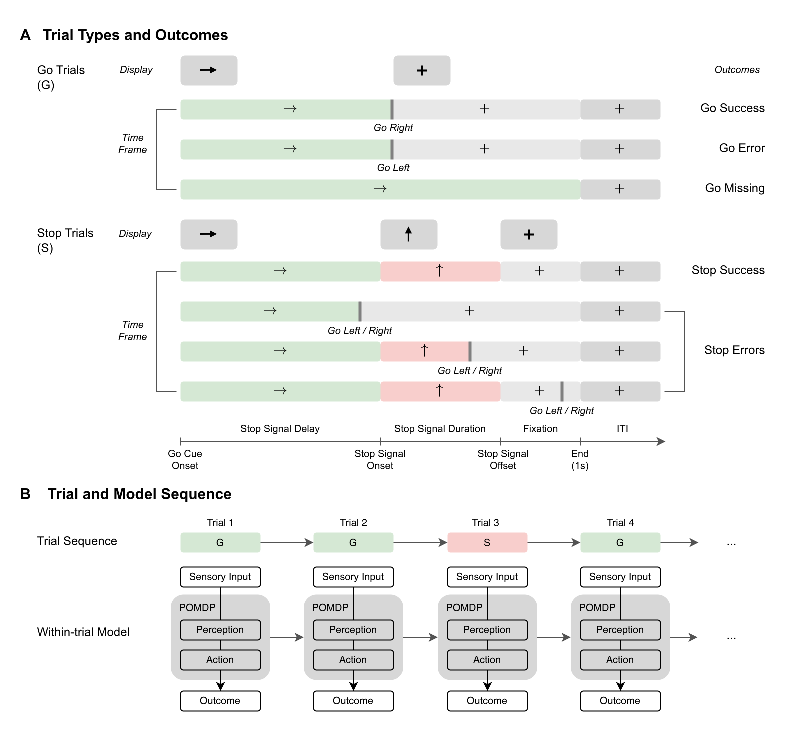
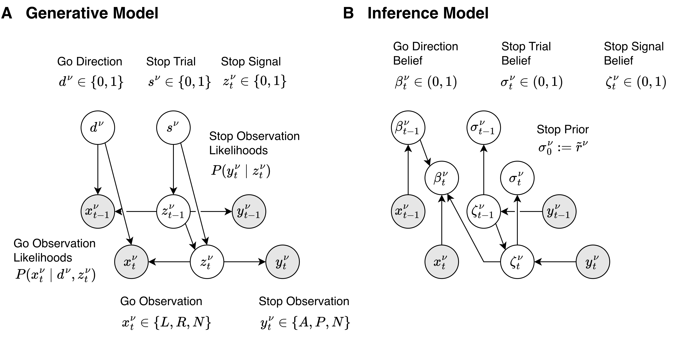
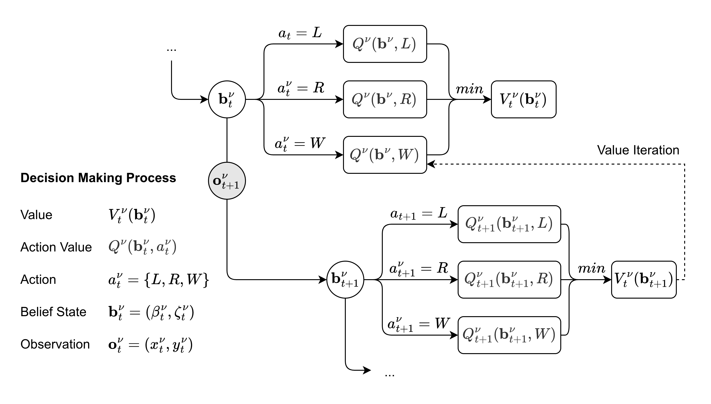
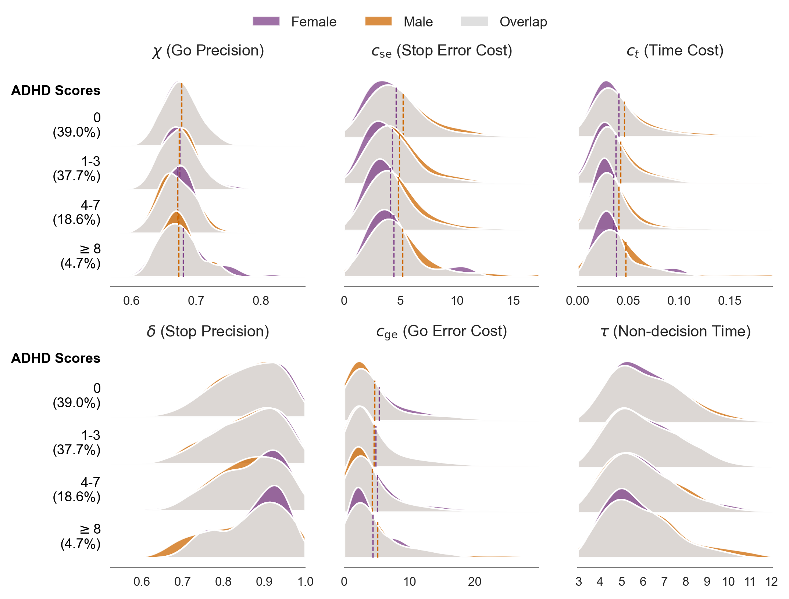
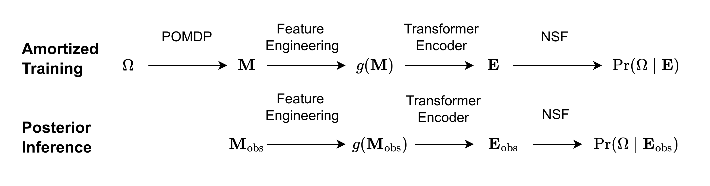
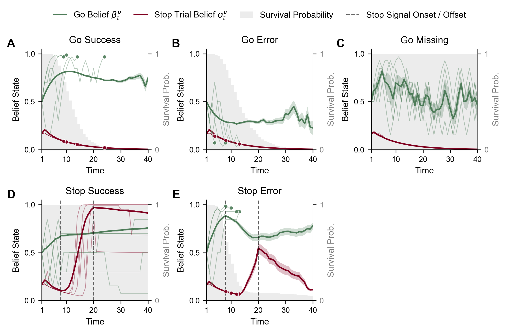
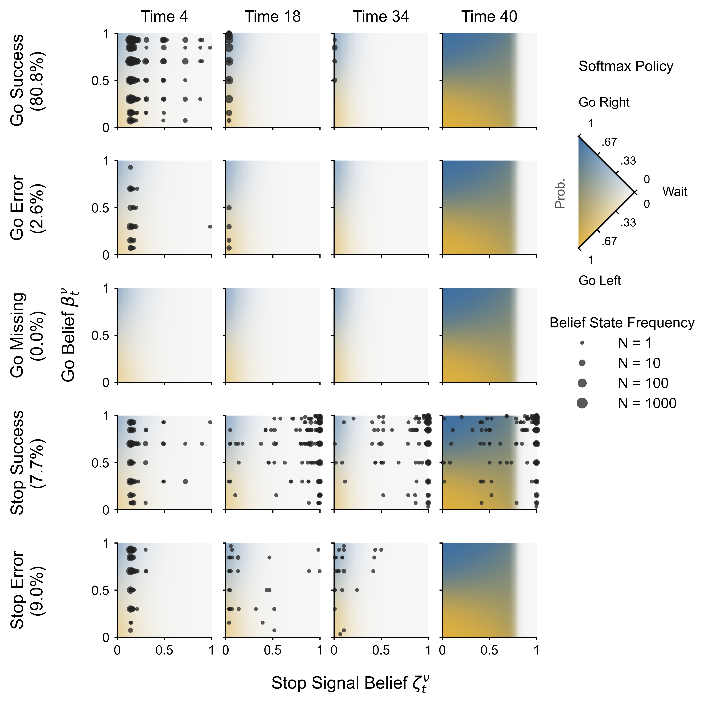
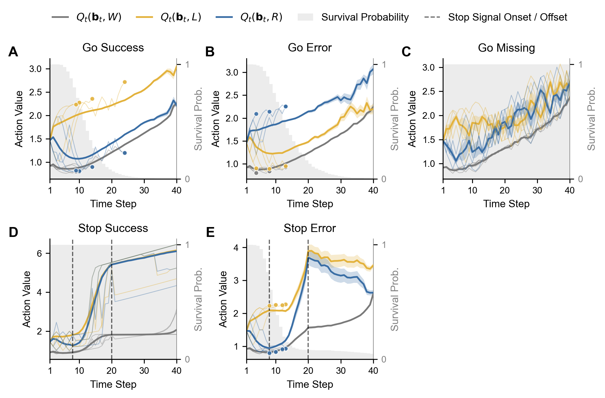
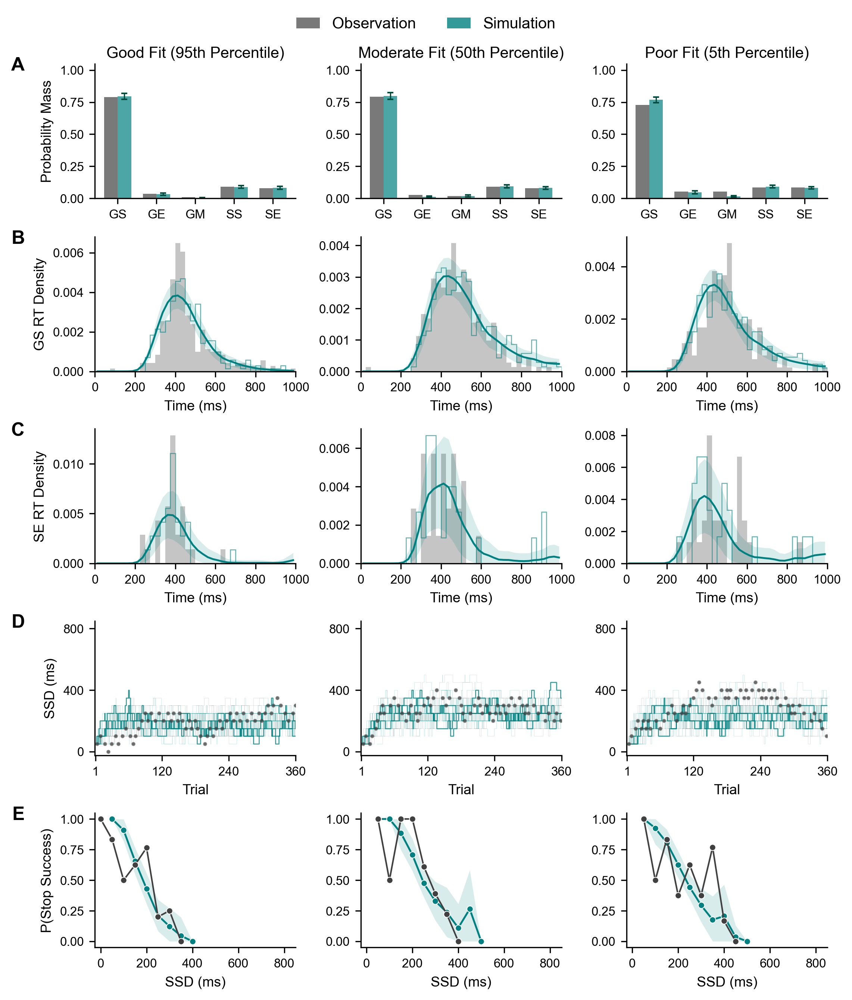

# Decomposing Response Inhibition: A POMDP Model

## Introduction

This repository contains the code for the research work [Decomposing response inhibition: a POMDP model](https://journals.plos.org/ploscompbiol/article?id=10.1371/journal.pcbi.1014068). It provides a comprehensive framework to formalize and parameterize the within-trial cognitive processes underlying the Stop Signal Task (SST), specifically tailored to the Adolescent Brain Cognitive Development (ABCD) study design.

The repository includes:
* **Data Processing:** Full pipelines for filtering, cleaning, and formatting behavioral data.
* **Computational Model:** The core Partially Observable Markov Decision Process (POMDP) cognitive model.
* **Model Fitting:** The inference pipeline Transformer-encoded Simulation-Based Inference (TeSBI).
* **Versatile Analysis:** Comprehensive scripts for parameter recovery, Posterior Predictive Checks (PPC), latent embeddings, statistical evaluation, and more.

Crucially, this project focuses on the relationship between computational phenotypes (i.e., inferred model parameters) and clinical traits (i.e., ADHD, sex, IQ and medication) within large-scale datasets of children (N > 5000).

This code is structured to allow for easy environment setup, local testing, and full High Performance Computing (HPC) deployment.

<p align="center">
  
</p>

<p align="center">
  
</p>

<p align="center">
  
</p>

<p align="center">
  
</p>

<p align="center">
  
</p>

## Quick Start

We provide an automated quick run test. It skips the raw data processing, uses the provided mock processed data, runs a model sanity check, performs a lightweight parameter inference, and tests all analysis scripts. It is designed to finish in a few minutes.

1. Clone the repository and enter the directory:
```bash
git clone git@github.com:wenting-wang/sst-pomdp.git
cd sst-pomdp
```

2. Create and activate the Conda environment:

You can set up your environment using either Conda or standard Python.

**Option A: Using Conda (Recommended)**

```bash
conda env create -f environment.yml
conda activate sst-pomdp-env
```

**Option B: Using standard Python (**`venv`**)**

If you do not have Conda installed, you can use Python's built-in virtual environment and `pip`:

```bash
python3 -m venv sst-pomdp-env
source sst-pomdp-env/bin/activate
pip install -r requirements.txt
```

3. Run the automated check:

```bash
python run_quick_check.py
```

If successful, the script will output `ALL TESTS PASSED SUCCESSFULLY!`.

Note on verification: You can compare your locally generated test files in outputs_example/ against the ground-truth reference files pre-compiled inside the outputs_example_expected/ directory to ensure perfect alignment.


## Detailed Guide

To reproduce the full pipeline used in the paper, follow these steps.

### Step 1: Data Cleaning (Optional)

If you have the raw datasets, you can run the quality control and filtering steps. Otherwise, you can skip this step and use the provided subject-level mock data in `data/example_*.csv`, and trial-level mock data in `data/example_processed_data/`.

```bash
# Optional: Run QC on raw data
python utils/01_qc_filter.py
python utils/02_qc_report.py
python utils/03_build_dataset.py
python utils/04_demo_report.py
```

### Step 2: Model Sanity Check

Before fitting data, verify that the core POMDP model simulates dynamics of within-trial belief states, action values, and stop prior effects properly. This generates theoretical plots of the model's behavior.

```bash
# Generates the within-trial dynamics figures
python analysis/fig_dynamics.py
```

**Expected Output:** `fig_belief_states.png`, `fig_action_value.png`, and `fig_stop_prior_sensitivity.png` plots saved in the `outputs_example/` folder.

```bash
# Generates the softmax policy figures
python analysis/fig_policy.py
```

**Expected Output:** `fig_policy_summary.png`, `fig_policy_GS.png`, `fig_policy_GE.png`, `fig_policy_GM.png`, `fig_policy_SS.png`, and `fig_policy_SE.png` plots saved in the `outputs_example/` folder.

### Step 3: Model Fitting

The main parameter inference pipeline uses a Transformer encoder and a SNPE neural network, which is quite computationally heavy for PCs. To reproduce the paper's full results, deploy the SLURM script on an HPC cluster with GPU access:

```bash
sbatch slurm/run_tesbi.sh
```

Note: To test a fast version of this locally, `run_quick_check.py` invokes `hpc/test_tesbi_e2e_6p_v1.py` with minimal epochs. This lightweight check generates a partially-trained network saved with a test_ prefix (e.g., `test_amortized_inference_net_6p_v1.pth`).

The end-to-end TeSBI pipeline includes several stages:

- Amortized Training: Learns a direct mapping from sequential, trial-level behavioral choices into continuous parameter densities using a Transformer encoder combined with a Neural Spline Flow (NSF) network architecture.

- Posterior Inference: Rapidly samples individual subject-level parameters from observed behavioral matrices using the pretrained network.

- Parameter Recovery: An integrated validation loop that test parameter identifiability.

For large-scale cross-validation or embedding extraction on cluster environments, you can directly deploy the corresponding cluster scripts such as `hpc/run_cv.sh` or `hpc/run_embed.sh`.

### Step 4: Results Analysis

Once the model is fit, or by using the pre-supplied example data in the `data/` folder, you can generate the figures and tables used in the manuscript. The analysis scripts are configured to read from the `data/` files so they work immediately out of the box.

```bash
# Generate the parameter distribution figure
python analysis/fig_param_dist.py

# Compare ADHD traits vs Model Parameters
python analysis/fig_param_adhd.py

# Run canonical correlation analysis (CCA)
python analysis/fig_cca.py

# Run posterior predictive checks (representative subjects)
python analysis/fig_ppc_reps.py

# Run PCA of latent behavioral embeddings analysis (2D)
python analysis/fig_pca_embed.py

# Generate demographics counts table (i.e., ADHD trait, sex, IQ, medication)
python analysis/tab_demo_counts.py

# Run linear models (behavior across demographics)
python analysis/tab_lm_behavior.py

# Run linear models to show relationship between model parameters and clinical traits
python analysis/tab_lm_params.py

# Run comprehensive model comparison
python analysis/tab_model_compare.py

# Generate parameter quantiles
python analysis/tab_param_quantiles.py
```

**Expected Output:** Final `.png` figures and `.tex/.csv` tables saved directly to the `outputs_example/` directory (with some results routed to `outputs_example/tesbi/`).

**Important Architectural Note on Pre-supplied Data**:
The files and directories pre-packaged inside `/outputs_example/tesbi/` (specifically `amortized_inference_net_6p_v1.pth`, `example_ppc_metrics_6p_v1.csv`, `model_cv`, `model_posteriors`, `model_ppc`, `model_recovery`, and `model_spec`) represent actual full production-grade results extracted from a fully trained pipeline via `example_data_generator.py`. They are provided out-of-the-box so that the downstream analysis scripts (`analysis/*.py`) can execute immediately with high-fidelity scientific data. They are not the output of the local quick check test process, which intentionally runs an incomplete, lightweight training session to verify environment sanity.

## Project Structure

The repository is divided into modular folders separating the core computational model, scalable inference on HPC, and downstream analysis.

* **`analysis/`**: Scripts to generate all paper figures and tables.

* **`core/`**: The fundamental computational and simulation modules.
  * `models.py`: The POMDP model.
  * `simulation.py`: Trial-level and task-level simulation.
  * `plotting.py`: Visualization of within-trial dynamics and policy.


* **`data/`**: Contains mock data in `example_processed_data/` and mock summary `.csv` files to allow users to test the analysis scripts without needing the raw, restricted clinical dataset.

**`hpc/`**: Heavy computational and estimation pipelines designed for cluster environments.

- `run_tesbi.sh`: Core submission bash script used to test and train specific model configurations on `SLURM` by defining variables like `MODEL_FILE="tesbi_e2e_6p_v1"`, which dynamically links architecture details from `outputs_example/tesbi/model_spec/`.

- `run_cv.sh`: Main script for cross-validation runs to perform statistical model comparison across candidate parameter sets.

- `run_embed.sh`: Extract high-dimensional latent sequential behavioral embeddings using the optimized network configuration.

- `eval_*.py` & `plot_*.py`: Auxiliary code and plotting modules serving as background engines during model evaluation, validation checks, and diagnostic plots.

**`outputs_example/`**: Active directory for runtime test artifacts. It contains pre-supplied full production-grade models and tracking files mapped via `example_data_generator.py`. Local verification tests write separate checking files marked with a `test_` prefix (e.g., `test_amortized_inference_net_6p_v1.pth`).

**`outputs_example_expected/`**: Reference directory containing frozen ground-truth targets (figures, tables, metrics) reflecting a perfect, full production execution on the mock datasets. Following a successful `run_quick_check.py` run, the files created in `outputs_example/` should perfectly mirror the corresponding records here.

* **`utils/`**: Data processing, quality control, and system checks.
  * `01_qc_filter.py`, `02_qc_report.py`, `03_build_dataset.py`, `04_demo_report.py`: Pipelines for filtering raw data and building analysis datasets.
  * `preprocessing.py`: Trial-level data cleaning and formatting.
  * `metrics.py`: Extract behavioral metrics.
* `environment.yml`: Environment setup file to install necessary dependencies.


## Reference

For full theoretical details, mathematical derivations, and comprehensive results, please refer to our paper: 

[Wang, Wenting, Tobias Kaufmann, and Peter Dayan. "Decomposing response inhibition: a POMDP model." PLOS Computational Biology 22.9 (2026): e1014068.](https://journals.plos.org/ploscompbiol/article?id=10.1371/journal.pcbi.1014068)

## Contact

If you have any concerns, have questions, or want to discuss the code, please feel free to open an issue on this repository or reach out directly:

Wenting Wang (wenting.wang@tuebingen.mpg.de)

## Result (examples)

<p align="center">
  
</p>

<p align="center">
  
</p>

<p align="center">
  
</p>

<p align="center">
  
</p>

